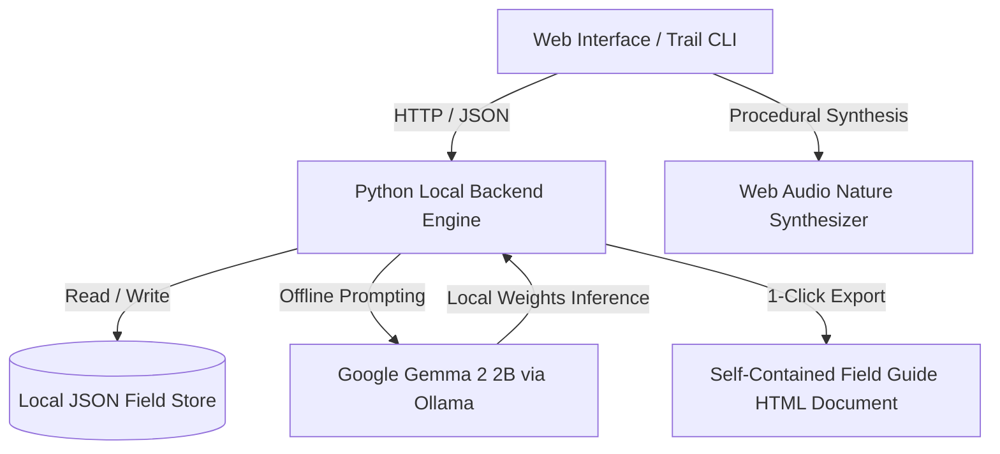

# 🌲 TerraScout AI: Touch Grass

> *"In every walk with nature, one receives far more than he seeks."* — John Muir

[](https://opensource.org/licenses/MIT)
[](https://ai.google.dev/gemma)
[](https://ollama.com)
[](https://dev.to/challenges/hf26)

**TerraScout AI** is a 100% local-first, offline backcountry trail dispatcher, wild forager oracle, and field naturalist companion built for **Hacktoberfest 2026 (Week 1: Touch Grass)**.

Powered by **Google's open-weight Gemma 2 2B model** running locally via Ollama, **TerraScout AI** is intentionally engineered as an **Anti-Dopamine / Screen Minimizer**: it gives you a rapid 30-second field briefing on target flora, birdsong, and toxic hazards, and then commands you to pocket your phone and step onto the trail.

---

## 🌟 Why Open Innovation Matters: The Core Principle

Most modern AI apps are built around cloud APIs and designed to maximize screen time, keeping your eyes locked onto a smartphone. For outdoor exploration, that model completely fails:

1. **Zero Cellular Signal in Deep Wilderness:**
   Nature has no 5G towers. When hiking down into steep mountain ravines, traversing ridgelines, or exploring national parks, commercial cloud APIs fail with network timeouts. **TerraScout AI** runs open-weight **Gemma 2** entirely on your laptop or device's RAM with zero bars.
2. **Foraging Sovereignty & Location Privacy:**
   Foragers guard their secret morel, chanterelle, and wild ginseng spots with fierce secrecy. Uploading photos or GPS logs to cloud APIs leaks private locations to commercial data brokers. With local open-weight AI, your data never leaves your device.
3. **The Anti-Dopamine Screen Minimizer:**
   Commercial AI traps you in prolonged chat loops. **TerraScout** generates a structured, high-density 30-second field dispatch, starts an off-screen timer, and urges you to pocket your device.

---

## ✨ Features

- **⚡ 30-Second Trail Dispatch:**
  - Select your activity (Hiking, Wild Foraging, Birding, Trail Running), biome (Temperate Forest, Mountain Ridge, Wetland, Meadow), season, and duration.
  - Generates instant actionable briefings with 2 target species, 1 critical toxic lookalike warning, and a call to step outside.
- **🔍 Backcountry Naturalist Oracle:**
  - Query wild specimens on the trail (e.g., egg-yolk yellow funnel mushroom with blunt ridges, indigo songbird with shaggy crest).
  - Evaluates edibility, diagnostic confirmation markers, toxic lookalikes, and ecological importance.
- **📖 Offline Botanical & Wildlife Compendium:**
  - Pre-indexed database of edible vs deadly lookalikes (Golden Chanterelle vs Jack-o'-Lantern, Morel vs False Morel, White Pine Needle Tea vs Yew, Wild Blackberry vs Poison Hemlock).
- **🧭 Touch Grass Timer & Telemetry Dashboard:**
  - Tracks total minutes spent off-screen in the wild.
  - Calculates estimated screen time saved.
  - Logs field sightings with timestamps.
  - Generates an AI-authored naturalist field journal reflection upon finishing an expedition.
- **🎵 Pure Procedural Nature Soundscape (Web Audio API):**
  - Synthesizes rustling canopy breezes and procedural birdsong warbles live in the browser using pure mathematical oscillators — **zero external MP3 files**.
- **📜 1-Click Standalone Field Guide HTML Export:**
  - Exports a clean, self-contained single-file HTML field guide of your expedition that can be printed or archived offline.
- **💻 Backpacker's Terminal CLI (`cli/trail_cli.py`):**
  - Lightweight ANSI terminal companion for field laptops with zero battery waste.

---

## 🏗️ System Architecture



---

## 🚀 Quickstart

### Prerequisites
1. **Python 3.10+** (Standard library only; zero mandatory pip dependencies!).
2. **Ollama** with Gemma 2:
   ```bash
   ollama pull gemma2:2b
   ```
   *(If Ollama is not installed or running, TerraScout AI automatically falls back to its built-in offline field rulebook!)*

### Running the Web Interface
Double-click `run.bat` or run:
```bash
python backend/app.py 8081
```
Then open [http://localhost:8081](http://localhost:8081) in your browser.

### Running the Terminal CLI
Double-click `run_cli.bat` or run:
```bash
python cli/trail_cli.py
```

### Running the Automated Test Suite
```bash
python tests/test_suite.py
```

---

## 🏆 Hacktoberfest 2026 Alignment

| Category | Qualification |
| --- | --- |
| **Theme: Touch Grass** | Specifically built to get people off the screen and into the wild, with an anti-dopamine screen-minimizing dispatcher and off-grid field guide. |
| **Featured Partner: Best Use of Gemma ($200)** | Uses **Google Gemma 2 2B** (`gemma2:2b`) running locally via Ollama for sub-second, deeply knowledgeable botanical and trail reasoning with zero internet. |
| **Open Innovation Core** | 100% offline, private, zero telemetry, air-gapped field journal preservation. |

---

## 📄 License

MIT License &copy; 2026 Shashiharan Ram Vanam.
Dedicated to open trails and wild places.
